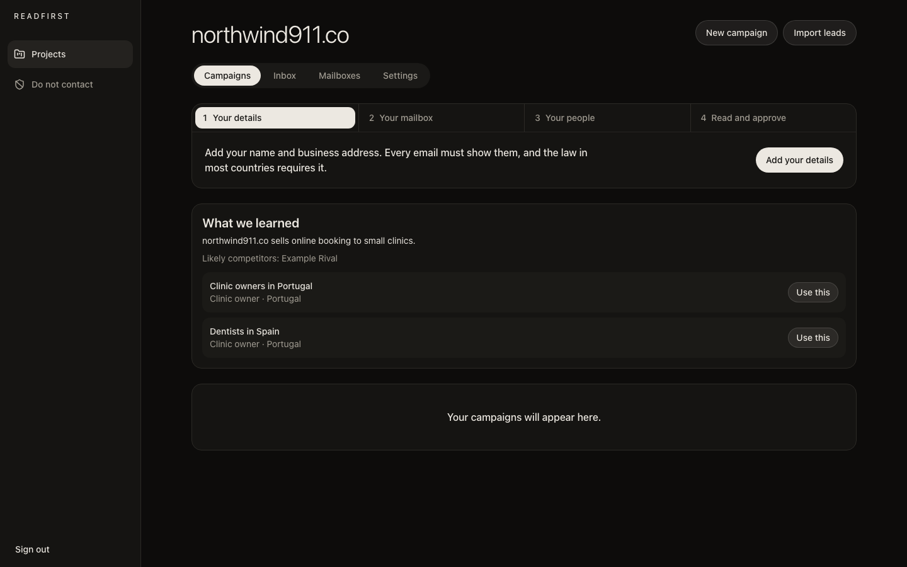

# Readfirst

**Cold email that sends nothing until you have read it.**

Readfirst is a free, open-source app for founders and small teams who find their own customers by email. It helps you describe your business, pick the people to write to, write a personal first email to each of them, send from your own mailbox, and sort the replies. Two rules hold everywhere: nothing leaves until you approve it, and spending never passes the limit you set.

It runs as a desktop app on macOS, Windows and Linux, or as a small self-hosted web app.



## What it does

- **Understands your business.** Reads your website, or a few lines you write, and suggests who to contact.
- **Takes your list.** Import a CSV from any spreadsheet. It handles Excel exports, accents and semicolons, and drops duplicates, invalid addresses and anyone who asked not to be contacted. Lead search and email checks through People Data Labs and ZeroBounce are optional.
- **Writes each email.** An AI writes a first email and follow-ups for each person, from facts you give it. Or write your own template with `{{first_name}}`-style fields.
- **Shows you samples first.** You read real samples before you approve a campaign.
- **Sends from your mailbox.** Gmail, Outlook or any SMTP and IMAP account, at a daily limit you choose, in the hours you choose, with gaps between emails.
- **Sorts replies.** Replies land in one inbox, threaded. Each one is marked interested, asking for a meeting, not now, not interested or unsubscribe, and follow-ups stop the moment someone answers.
- **Keeps you lawful.** Your name and postal address go in every email, every email has an opt-out, a do-not-contact list is checked before every send, and you can erase a person on request.

## Who does the AI work

You choose, in Settings:

| Option | What it costs | How it works |
| --- | --- | --- |
| **Your own AI agent** (default in the desktop app) | Uses the plan you already pay for | Claude Code, Codex, Cursor or any agent that speaks MCP connects to Readfirst and does the writing and sorting when you ask it to |
| **Anthropic or OpenAI API key** | Pay per use, capped by your budget | Readfirst calls the API itself, in the background |
| **A local model** through Ollama or any OpenAI-compatible server | Free per email | Same as an API key, on your own machine |
| **No AI** | Free | Import, your own template, sending and the inbox all still work |

### Connect your AI agent

Open **Settings → Connect your AI agent** in the desktop app. It shows the exact command with your address and token filled in, for example:

```bash
claude mcp add --transport http readfirst http://127.0.0.1:47210/api/mcp --header "Authorization: Bearer <your token>"
```

For Codex, set the token in an environment variable and run `codex mcp add readfirst --url http://127.0.0.1:47210/api/mcp --bearer-token-env-var READFIRST_TOKEN`. Cursor and other agents take the `mcp.json` block shown on the same screen.

Then ask your agent: *"Do my Readfirst work."* Keep Readfirst open while it works.

The agent gets these tools:

| Tool | What it does |
| --- | --- |
| `readfirst_overview` | Lists your projects and the work waiting in each |
| `get_business` / `save_business_analysis` | Reads what is known about a business and stores the agent's description and campaign ideas |
| `list_samples_to_write` / `save_samples` | Sample emails for a campaign, which you read before approving it |
| `list_emails_to_write` / `save_email` | The text of approved emails, which Readfirst then sends on schedule |
| `list_replies_to_sort` / `sort_reply` | Marks what each reply means. An unsubscribe stops all email to that person |

The agent cannot approve or send anything. Every email it writes passes the same checks as the built-in AI: no links you did not give it, no prices, no promises, and no claims beyond the facts you entered.

Using your own agent this way is ordinary use of that agent: you run it, and Readfirst only offers it tools. Readfirst never stores or uses your Claude or ChatGPT sign-in.

## How it works

```
You ──approve──▶ Readfirst ──SMTP──▶ the people you chose
                    ▲   │
        MCP tools   │   └──IMAP──▶ replies, threaded and sorted
                    │
           your AI agent, or an API key, or no AI
```

The desktop app bundles everything: a Postgres database, the web interface and a background worker that sends and checks mail. All of it runs on your computer and talks only to your mail provider and, if you choose one, your AI provider. Keys and mailbox passwords are encrypted on disk.

Because the desktop app has no public web address, people opt out by replying "stop". Readfirst catches that itself, with or without AI.

Sending and reply checks run while the app is open. For around-the-clock sending, self-host the web version on a server.

## Install the desktop app

Download the installer for your system from [Releases](../../releases).

- **macOS** (Apple silicon): open the `.dmg` and drag Readfirst to Applications. The app is not signed with a paid Apple certificate, so the first time, open it, then go to System Settings → Privacy & Security and choose **Open Anyway**.
- **Windows**: run the `.exe`. SmartScreen may warn about an unknown publisher: choose **More info → Run anyway**.
- **Linux**: run the `.AppImage`, or install the `.deb`.

Your data stays in the app's data folder (`~/Library/Application Support/Readfirst` on macOS, `%APPDATA%\Readfirst` on Windows, `~/.config/Readfirst` on Linux). Removing the app leaves it in place.

### Your first campaign

1. Create a project with your website.
2. Follow the four steps the project shows: your details, your mailbox, your people, read and approve.
3. For the mailbox, use a separate sending domain and an app password, not your main password. Start at 5 to 10 emails a day.
4. Test with two addresses of your own before writing to anyone else.

## Self-host the web version

Needs Node 22 and Postgres 16.

```bash
npm ci
createdb outreach
for f in db/migrations/*.sql; do psql -d outreach -f "$f"; done
cp .env.example .env.local
npm run build
npm start
```

In another terminal, run the worker with `npm run worker`. Fill in `.env.local` first: every setting is explained in [.env.example](.env.example). Sign-in uses Google, limited to the addresses in `ALLOWED_EMAILS`. A `Dockerfile` and `docker-compose.yml` are included but have not been tested yet.

To let an agent work on a self-hosted install, set `MCP_TOKEN` to a long random value and `MCP_EMAIL` to the account it works for.

## Develop

```bash
npm ci
cp .env.example .env.local   # add DEV_LOGIN=1, AI_FAKE=1 and the MAIL_DEV lines
npm run mail:dev             # a fake mail server on this machine
npx next dev
npm run worker
```

`AI_FAKE=1` gives canned AI, lead and email-check answers, so tests cost nothing. A production build refuses it.

```bash
npm test               # unit tests
npx playwright test    # browser tests; needs the three processes above and Postgres on port 54329
```

Build the desktop app with `npm install` and `npm run dist` in `desktop/`. `node desktop/smoke.cjs` opens the built app and walks through it. The GitHub workflow builds and checks the app on all three systems for every version tag.

The code is a Next.js app (`src/app`), a server layer (`src/server`), a pg-boss worker (`src/worker`), SQL migrations (`db/migrations`) and the Electron shell (`desktop`).

## Status

Version 0.1. The full flow is covered by automated tests against a local mail server. Not yet tested: real AI providers at volume, real mail providers beyond a basic check, the Docker image, the Windows and Linux builds on real machines, and screen readers. The interface is in English. Please report what breaks.

## Use it responsibly

You run this software and you send the email, so the laws that apply are yours to follow, including CAN-SPAM, GDPR, PECR and CASL. Contact only people you have a lawful reason to contact, and honour every opt-out. Nothing here is legal advice. The privacy and terms pages are templates: have a lawyer read them before you host Readfirst for other people.

## Contribute

See [CONTRIBUTING.md](CONTRIBUTING.md). Report security problems privately, as described in [SECURITY.md](SECURITY.md).

## License

[GNU AGPL-3.0](LICENSE). You may use, change and share Readfirst for free, including commercially. If you change it and let others use it over a network, you must offer them your source code under the same license.
